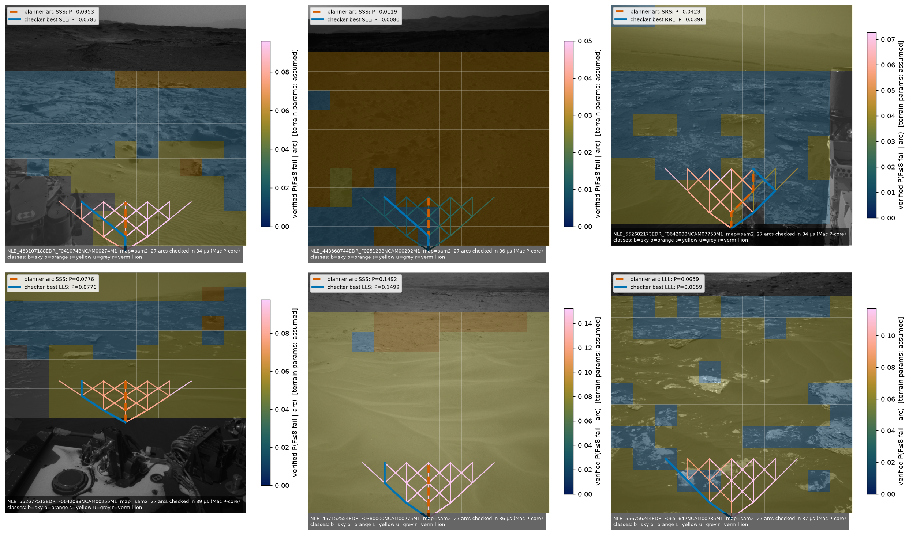

# Verified per-command safety for a Mars rover, computed on board

**Meta Global AI Developer Hackathon 2026 · Indie track · Push the Frontier**

Before a rover drives the arc its planner picked, this checker computes the
exact probability that the arc ends stuck or crashed within the next 8 range
bands, for every candidate arc, on the rover's own compute. The terrain model
it checks is built from the camera frame by a Meta perception model, and every
number the checker returns is validated against the PRISM model checker.



Demo video (2 min 54 s, English captions): `demo/video/demo_captioned.mp4`, captions in `demo/video/captions.srt`.

## Pipeline
1. **See** — a Curiosity Navcam frame from NASA's AI4Mars gold test set.
2. **Classify terrain** — SAM 2.1 (Meta, open weights) image-encoder features per
   16×16 patch + a linear probe → soil / bedrock / sand / big rock.
3. **Build the model on board** — the frame becomes a 10 × 11 range-bearing grid
   and a Markov decision process (slip, sink, collision, leaving the image).
4. **Check every arc** — a dependency-free C checker (`checker/edgecheck.c`,
   libc only, no allocation after load) evaluates P(F≤8 fail | arc) for all 27
   arcs, the continuation chosen to minimise failure.
5. **Veto / re-rank** — compare with the weighted-sum planner's choice.

## What was measured (all numbers from this repo's CSVs)
| claim | result |
|---|---|
| checker = PRISM on an independent 80-model oracle (MDPs + stochastic games) | 780/780 supported rows agree, worst error 1.1e-16 |
| Storm 1.14 in exact rational arithmetic vs PRISM and the checker (`storm_results.csv`) | 5084/5084 values agree, worst 2.2e-16 |
| checker's own on-board model build = PRISM on an independent encoding | 5084/5084 rows agree over 41 maps, worst error 8.3e-17 |
| all 27 arcs, scene grid, normal Mac core (thread CPU) | 25 µs |
| same, efficiency-core stand-in for a flight CPU | 95 µs |
| largest stress map (128×128, horizon 64), stand-in | 62.9 ms CPU |
| C code: every terrain map up to 3×3 (all class assignments) under AddressSanitizer + UBSan | 1,985,305 maps, 5,955,915 checks, no violation |
| SAM 2 probe, patch accuracy on 20 held-out scenes | 95.8 % |
| scenes where the checker finds a strictly safer arc than the planner (gold / SAM 2 maps) | 8/20 · 9/20 (max P saved 0.0168) |
| scenes vetoed at θ = 0.05 (gold / SAM 2 maps) | 13/20 · 6/20 |

## What we found — including what did not go as hoped
- The checker agrees with PRISM everywhere it was tested; that is the trust anchor.
- It is fast: the whole candidate set is checked in microseconds on a scene-sized grid.
- **Most vetoes say "stop", not "steer elsewhere."** In these 20 scenes there are no
  rock cells, so risk is accumulated sinkage along the drive and every arc of a
  scene shares most of it. The arc-level gain from re-ranking is real but small.
- **Perception moves the verdict more than arc choice does.** Where human labellers
  disagreed, the gold maps say "unknown" (treated as sand); SAM 2 classifies those
  cells, and the veto count drops from 13 to 6.
- Slip and sink probabilities per terrain class are **assumed** (no published
  table exists); absolute probabilities are conditional on them.
- SAM 2's automatic mask generator covered under 1 % of the terrain (it finds
  objects, not ground), so we used its encoder features with a linear probe.
  SAM 3.1's text-prompted concept segmentation ("sand", "bedrock") is the
  natural next arm.

## Reproduce

Requirements: a C99 compiler; Python 3.12+ with `numpy pillow matplotlib`
(`cmcrameri` optional); PRISM 4.10.1 and PRISM-games 3.2.4 on `PATH` (or set
`$PRISM`, `$PRISM_GAMES`) for the oracle comparisons; for the perception arm,
`torch`, `scikit-learn` and Meta's `sam2` package plus the SAM 2.1 Hiera-S
checkpoint in `checkpoints/` (or `$SAM2_CKPT`).

```bash
make test                              # builds the checker and replays 84 stored checker vs PRISM maps; needs only cc and python3
cc -std=c99 -O2 -o checker/edgecheck checker/edgecheck.c -lm
./checker/edgecheck terrain maps_sam2/NLB_463107188EDR_F0410748NCAM00274M1.txt terrain_params.csv 8 3

python3 kt4.py sam2 maps_sam2          # veto study on the committed class maps (no data download needed)
python3 invariants.py maps_sam2        # invariants I2-I6
python3 -I tools/fetch_ai4mars_test.py # 322 gold test scenes (~107 MB), only for the steps below
python3 kt1b.py maps/synth_a.txt maps_gold/*.txt maps_sam2/*.txt   # checker vs PRISM on an independent encoding
python3 storm_check.py                 # then Storm (--exact) vs both; needs storm on PATH
(cd oracle_m006 && bash run.sh)        # regenerate the 380-property PRISM oracle; then python3 kt1a.py
python3 sam_dense.py train && python3 sam_dense.py eval && python3 sam_probe.py   # perception arm
python3 gen_results.py                 # results.md from the CSVs
```

The class maps (`maps_gold/`, `maps_sam2/`), the SAM 2 label images and every
results CSV are committed, so the checker and the veto study run without any
download.
Pinned versions: `requirements.txt`, `requirements-sam2.txt`, `ENVIRONMENT.md`
(SAM 2 commit and checkpoint sha256). Citation: `CITATION.cff`.

## Licence and credits

Code: MIT (`LICENSE`). `maps_gold/` derives from AI4Mars labels (CC BY 4.0).

AI4Mars: Swan, Ono, Atha et al., CVPR Workshops 2021, Zenodo doi:10.5281/zenodo.15995036
(CC BY 4.0). SAM 2.1: Meta FAIR. PRISM / PRISM-games: Kwiatkowska, Norman, Parker et al.
